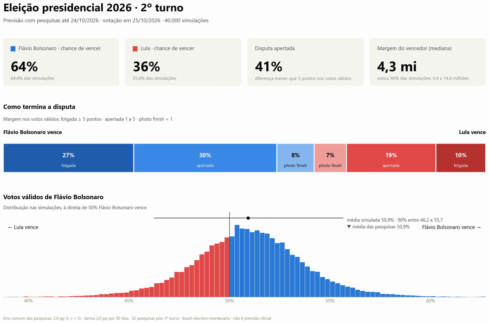

# brazil-election-montecarlo

Monte Carlo forecast of Brazil's presidential election from public polls. It gives the chance of leading the first round, of a runoff and of winning it, with uncertainty calibrated on the elections of 2010 to 2026.

[](https://opensource.org/licenses/MIT)
[](https://www.python.org/downloads/)
[](CHANGELOG.md)
[](https://github.com/gabrielrv13/brazil-election-montecarlo/actions/workflows/tests.yml)

The model aggregates the polls with house effects. It then simulates the election 40,000 times with an error shared by all polls, because pollsters tend to miss in the same direction. Every run writes a manifest, so it can be reproduced exactly. It is an educational and methodological project, not an official forecast.



*Runoff forecast with the polls available on the eve of the vote (`python -m src runoff --as-of 2026-10-24 --seed 42`): Flávio Bolsonaro 64% to win. Lula won with 51.8%, inside the forecast's 90% interval. The scoring of that forecast is in [docs/calibracao_fase3.md](docs/calibracao_fase3.md).*

---

## Usage

First-round forecast, with a fixed reference date and seed:

```bash
python -m src run --as-of 2026-10-03 --seed 42
```

```text
[2/4] Running simulation...
First-round event probabilities (contract v2):
  Lula: leadership=66.39%; direct victory (>50% valid)=3.56%; runoff qualification=95.17%
  F. Bolsonaro: leadership=33.62%; direct victory (>50% valid)=1.26%; runoff qualification=95.17%
  ...
  Second round occurs: 95.17%
Runoff victory, conditional on a runoff (dynamic top two):
  Lula: 65.34%
  F. Bolsonaro: 34.66%
...
Simulation completed. Results in outputs/ (manifest: 2026-11-12T17-49-04_manifest.json)
```

Runoff forecast, once the two finalists are known:

```bash
python -m src runoff --as-of 2026-10-24 --seed 42
python -m src runoff --vies 2 --vies-candidato "Flávio Bolsonaro"   # bias scenario, not a headline
```

| Command | What it does |
|---|---|
| `python -m src run` | First-round forecast plus the dynamic runoff (the actual top two of each draw). It is the default when no subcommand is given. |
| `python -m src runoff` | Runoff forecast from second-round polls. Only polls after the first round are used unless you pass `--data-min`. |
| `python -m src.calibracao` | Scores the 2026 forecasts and calibrates the common error on 2010–2026. |
| `python src/publicar_2turno.py --exigir-manifesto` | Publication gate: validates the runoff summary and its manifest, then writes PT/EN posts. |
| `python -m src backtest` | Backtest against the 2018 and 2022 snapshots in `data/historico/`. |
| `streamlit run src/viz/dashboard.py` | Interactive dashboard. |
| `python src/retrospectiva_1t.py` | First-round poll average versus the official result, per candidate. |

Main options of `run` and `runoff`: `--as-of`, `--seed`, `--n-sim`, `--sd-erro-comum`, `--gl-erro-comum`, `--sd-deriva`, `--sem-efeito-instituto`. `run` also takes `--cenario` and `--no-history`. `runoff` also takes `--data-min`, `--vies`, `--vies-candidato` and `--usar-teto`. Run either with `--help` for the full list.

Without `--seed`, the CLI draws a seed and records it in the manifest. The manifest also stores the git commit, library versions, reference date, parameters and the SHA-256 of every input and output.

---

## Install

```bash
git clone https://github.com/gabrielrv13/brazil-election-montecarlo.git
cd brazil-election-montecarlo
python -m venv venv
source venv/bin/activate          # Windows: venv\Scripts\activate
pip install -e ".[dev]"           # Python 3.11+; [dev] adds pytest and ruff
```

The dependencies are declared in [pyproject.toml](pyproject.toml): numpy (< 2.4), pandas, scipy, matplotlib, seaborn, streamlit and reportlab. PyMC and arviz are still installed, but they are not used: `--bayesian` is rejected.

---

## Poll data

First-round polls go in `data/pesquisas.csv`, one row per candidate per poll:

```csv
candidato,intencao_voto_pct,rejeicao_pct,desvio_padrao_pct,indecisos_pct,instituto,data
Lula,41.0,0.0,2.0,7.0,Nexus,2026-08-17
F. Bolsonaro,36.0,0.0,2.0,7.0,Nexus,2026-08-17
```

| Column | Required | Meaning |
|---|---|---|
| `candidato`, `intencao_voto_pct` | yes | Candidate and vote intention (% of all respondents). A `Brancos/Nulos` row sets the blank/null share. |
| `desvio_padrao_pct` | yes | The poll's published margin of error (95%), in pp |
| `data` | yes | Fieldwork date (ISO), never later than `--as-of` |
| `instituto` | recommended | Pollster; needed for house effects |
| `rejeicao_pct` | no | Rejection, used as an electoral ceiling (0 = not measured) |
| `indecisos_pct` | no | Undecided share, redistributed by electoral space |

Every poll must list the same candidates. An incomplete poll stops the run with an error that names the poll. Runoff polls use the same columns, with two candidates per poll, in `data/pesquisas_2turno.csv`.

---

## Outputs

`run` writes to `outputs/`, with a timestamp prefix:

| File | Content |
|---|---|
| `<ts>_probabilidades.csv` | Per candidate: `p_lideranca`, `p_vitoria_1t`, `p_classificacao_2t`, `p2t`, `p2v` (0–1) |
| `<ts>_resultados_1turno.csv`, `<ts>_resultados_2turno.csv` | One row per simulation |
| `<ts>_relatorio.pdf` | PDF report |
| `simulacao_brasil_2026.png`, `margem_1turno.png` | First-round dashboard and margin charts |
| `<ts>_manifest.json` | Reproducibility manifest |
| `forecast_history.db` | SQLite history of runs (skip with `--no-history`) |

`runoff` writes `resumo_2turno.json`, which is the input of the publication gate, plus `resultados_2turno_standalone.csv`, `simulacao_2turno.png` and `resumo_2turno.manifest.json`.

Leadership, direct victory (> 50% of valid votes) and runoff qualification are separate events. Use `p_lideranca`, `p_vitoria_1t` and `p_classificacao_2t`. The legacy `pv` means leadership, not victory. `p2v` is conditional on a runoff. See [docs/probability_events.md](docs/probability_events.md).

---

## How it works

1. **Aggregation.** Polls are weighted by recency (`exp(−days/7)`). House effects are estimated against the other pollsters and removed, and outliers are detected on detrended residuals.
2. **Common error.** Each simulation draws one election-wide polling error (sd 3.0 pp with Student-t tails) plus opinion drift until election day (2.0 pp per √30 days). On top of that comes the noise of the polling average. The common error carries almost all of the uncertainty: without it, Lula's chance of leading on the 2026-10-03 polls would be 98.8% instead of about 66%.
3. **Ceilings and undecided.** Rejection caps a candidate's share, with any excess redistributed to the others. Undecided voters are split by electoral space (100 − rejection).
4. **Votes.** Electorate → turnout → blank/null and valid votes, in both rounds.
5. **Runoff.** In `run`, the actual top two of each draw face each other. In `runoff`, each poll is reduced to the two-party share and goes through the same error model.

Formulas, defaults and the legacy v2.10 runoff script are in [docs/metodologia.md](docs/metodologia.md).

---

## Accuracy and limits

- **Calibration.** On ten cases (both rounds, 2010–2026), the maximum-likelihood common error is 3.5 pp (95% interval 1.9–6.6). The 3.0 default scored better out of sample, so it is kept. Details are in [docs/calibracao_fase3.md](docs/calibracao_fase3.md).
- **Directional misses.** The main non-PT candidate was under-polled in all five first rounds (+4.4 pp on average, mostly 2010 and 2014). Runoff errors average −0.7 pp. This is not built into the model; treat it as a scenario.
- **Sources.** The 2010–2022 calibration polls come from Wikipedia ([data/wikipedia](data/wikipedia/README.md)), not from TSE records. The audited catalogue in `data/historico_v2` is still quarantined.
- **Priors.** Drift and tail heaviness are not yet calibrated.

To publish a forecast, follow [PUBLISHING.md](PUBLISHING.md): final run, publication gate and posting rules.

---

## Contributing

See [CONTRIBUTING.md](CONTRIBUTING.md) for setup, tests, repository structure and the poll-update workflow. Version history is in [CHANGELOG.md](CHANGELOG.md).

## Acknowledgements

Inspired by the Hungarian election visualization by [u/Exciting-Lab1263](https://www.reddit.com/user/Exciting-Lab1263/) on [r/dataisbeautiful](https://www.reddit.com/r/dataisbeautiful/s/ZspHq3TH3R), which applied the [Chronicler-v2 methodology](https://www.szazkilencvenkilenc.hu/methodology-v2/) to the 2026 Hungarian parliamentary election.

## License

MIT, see [LICENSE](LICENSE). Results are not official electoral forecasts; official polls are those registered with the TSE.
