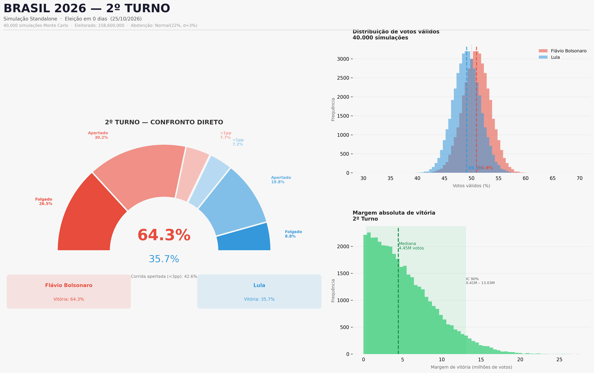

# Brazil Second-Round Simulation - 25 October 2026

## Scope and provenance

This report documents two runs of the repository's standalone second-round simulation (`src/simulation_2turno.py`, version shown by the program as v2.10).

- Code/data repository commit at run time: `bd73e1e` (`data: update second-round polls and rejection rates`)
- Run date: 25 October 2026
- Poll data in the checked-in datasets were validated through 24 October 2026.
- Simulation count: 40,000 per scenario
- Aggregation base: `fatia`
- Random seed: 42, as configured in the script
- Both runs used `sd_fatia_pp=2.5`, `vies_pp_a=0.0`, and `tau=7.0`.
- The run timestamps are recorded separately in each JSON summary.

These files record model outputs based on polling data. They are not official election results, and the simulated intervals are conditional on the model's assumptions and input data. They should not be interpreted as guarantees or as independently validated probabilities.

## Scenario results

### Base completa

- Execution timestamp (UTC): `2026-10-25T13:25:20+00:00`
- Input dataset: `data/pesquisas_2turno.csv`
- Poll records: 108
- Effective sample size (Kish): 43.0
- Institutes: 20
- Mean sum of both candidates in polls: 92.2%
- Aggregated two-candidate share, Flávio Bolsonaro: 50.929%
- Model-generated victory-probability output, Flávio Bolsonaro: 64.28%
- Model-generated victory-probability output, Lula: 35.72%
- 90% simulation interval for Flávio Bolsonaro's valid-vote share: 46.74% to 55.06%
- Median absolute margin: 3.61 percentage points
- Median absolute vote margin: 4,452,028
- Parameters: `sd_fatia_pp=2.5`, `vies_pp_a=0.0`, `tau=7.0`, `data_min=None`

### Base pos-definicao

- Execution timestamp (UTC): `2026-10-25T13:28:59+00:00`
- Input dataset: `data/pesquisas_only_2turno.csv`
- Poll records: 52
- Effective sample size (Kish): 40.5
- Institutes: 20
- Mean sum of both candidates in polls: 94.3%
- Aggregated two-candidate share, Flávio Bolsonaro: 50.945%
- Model-generated victory-probability output, Flávio Bolsonaro: 64.50%
- Model-generated victory-probability output, Lula: 35.50%
- 90% simulation interval for Flávio Bolsonaro's valid-vote share: 46.76% to 55.08%
- Median absolute margin: 3.62 percentage points
- Median absolute vote margin: 4,463,864
- Parameters: `sd_fatia_pp=2.5`, `vies_pp_a=0.0`, `tau=7.0`, `data_min=None`

## Sensitivity analysis

The model also reports a sensitivity table for the post-definition dataset. Rows are bias shifts in percentage points toward the first candidate; columns are the assumed standard deviation of the share.

| Bias shift (pp) | SD 0.8 pp | SD 1.5 pp | SD 2.5 pp | SD 3.5 pp |
|---:|---:|---:|---:|---:|
| -1.0 | 47.1% | 48.5% | 49.1% | 49.5% |
| 0.0 | 88.4% | 73.6% | 65.0% | 60.8% |
| 1.0 | 99.3% | 90.4% | 78.2% | 71.2% |
| 2.0 | 100.0% | 97.4% | 88.1% | 79.5% |
| 3.0 | 100.0% | 99.5% | 94.3% | 87.0% |

The sensitivity analysis uses separate simulation samples from the main run. Small differences between the main-run output and the corresponding sensitivity-table cell are therefore possible due to Monte Carlo variation.

## Comparison and limitations

The two scenarios use different polling datasets but identical principal simulation parameters. The complete dataset contains 108 poll records; the post-definition dataset contains 52. Their effective sample sizes are 43.0 and 40.5, respectively.

The results depend on the polling inputs, temporal weighting (`tau`), assumed share uncertainty, and other model assumptions, including turnout assumptions embedded in the implementation. The outputs do not account for uncertainty beyond what the model represents.

## Files

- `previsao_2turno_base_completa.json` - summary for the complete dataset
- `previsao_2turno_base_completa.png` - chart for the complete dataset
- `previsao_2turno_base_pos_definicao.json` - summary for the post-definition dataset
- `previsao_2turno_base_pos_definicao.png` - chart for the post-definition dataset

The full simulation CSVs were intentionally excluded from this report package; they remain in the local run directories.
